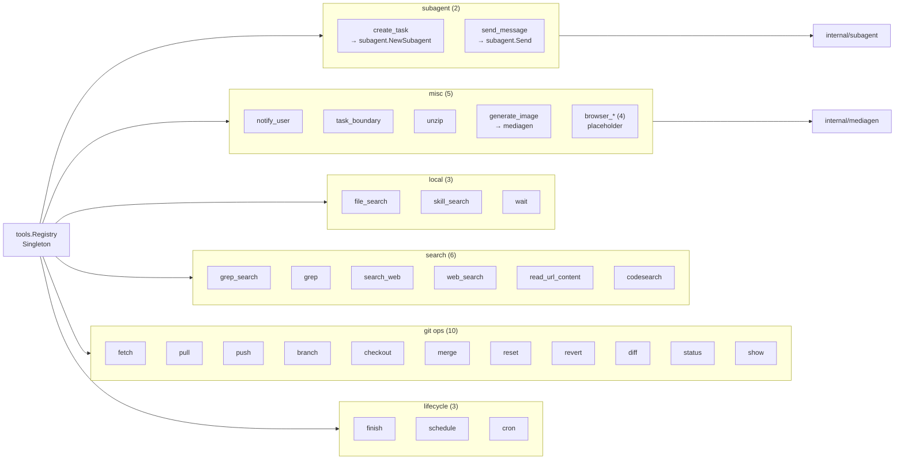
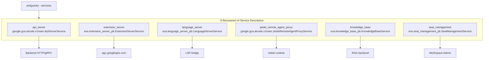

# Antigravity CLI — 反向工程重建仓库

> ⚠️ 本仓库是 **reverse-engineering 研究工作台**, 分两部分: `out/` + `rea-go-seeds/`
> 是研究证据 (报告 / seed / 反编译产物, 不是程序), `cmd/` + `internal/` 是基于这些
> 证据从零重写的 **Antigravity CLI 克隆** (可 build 可跑, 见下).
> 来源二进制为 Google 内部闭源 Antigravity CLI (`agy`), 分析的版本跨度 v1.3.3 → v1.4.0.
> 所有产出的 Go 代码均来自 pclntab 名称恢复 + Ghidra C 反编译 + 人工整理,
> 仅作结构分析使用, 不复制任何 Google 拥有源代码。

[](https://github.com/chadgpt/openagy/actions/workflows/test.yml)
[](./LICENSE)
[](https://go.dev/)

---

## 项目介绍

本仓库 (`chadgpt/openagy`) 是对 Google **Antigravity CLI** (`agy`)
这一闭源 Google 内部 monorepo 代理命令行工具 (源自 `google3/third_party/jetski/...`)
所做的反向工程重建工作。Antigravity CLI 是用 Google 内部 Go 工具链
(`go1.28-20260921-RC02`, tags `fieldtrack,boringcrypto,simd`) 编译的
180–214 MB 大型二进制, 内置 7 个 OAuth 端点 + 27+ gRPC 服务 + 32 个 LLM 模型 + 80+ 实验 flag。

**本仓库做了什么**:

1. 从 stripped Go binary 的 `pclntab` 段恢复 **155,554 个函数名** (cycle 12-13)
2. 用 Ghidra 12.1.4 对 2,000 个 priority func 做 **C 反编译** (1289 个 .c file)
3. 写了一个 175 行 stdlib-only Go 工具 `pclnseeds` 重建符号 (REA seed)
4. 在 cycle 25-30 把 1.3.3 + 1.3.4 + v4 binary 三套产物融合成可 build / test 的 Go 重建
5. 实现 CLI surface (24 flag + 12 subcommand) + 32 tool + 6 gRPC service 跟 v4 对齐
6. 持续跟真机 `agy` 发布的版本做逐 cycle 的 TUI / 行为对齐 (cycle 39 → 282, 共 204 个编号 cycle 目录)
7. cycle 183: 把 `internal/agent` 的手写 agent loop 换成第三方 `PiG` 的
   `agent` 包, 并用自写的 `internal/piagentbridge` agw provider 承接 agw 传输

### 克隆 (`cmd/` + `internal/`) 现状

| 维度 | 数值 |
|---|---|
| HEAD (本表撰写时) | `34dd744` (cycle `reference-drift`) |
| commit 总数 (同上) | 772 |
| cycle 目录 | `docs/cycles/cycle-*/` 共 204 个 (另有 168 个命名 slug, 合计 372 条目) |
| `go build ./cmd/wagyu` | ✅ 102,078,354 B (102.1 MB) |
| 二进制入口 | 8 (`wagyu` / `agy` / `openai-shim` / `anthropic-shim` / `openagy-models` / `agy228probe` / `hpgen` / `pigloop-demo`) |
| `internal/` 包 | 64 |
| `go list ./cmd/... ./internal/...` | 73 packages |
| `go test ./cmd/... ./internal/...` | ✅ 66 packages ok, 3,628 个 `Test*` + 1,530 子测试 (357 个 `_test.go`) |
| agent loop | PiG `agent` (`github.com/MichaelKinsy/PiG v0.4.1`) + `internal/piagentbridge` |

> 上面这些数字是一次快照, 会随 cycle 变旧. 参考二进制的版本漂移由
> `internal/referencedrift` 的 gate 盯着 (见 `docs/cycles/reference-drift/`);
> 但本表本身的数字没有 gate 覆盖, 读到这里请以实测为准.

**不要用 `go test ./...`** — `scratch/` 自建立起就无法编译. 用
`go test ./cmd/... ./internal/...`.

`gofmt -l` 在 `internal/` 上不是干净的 (50 个文件, 历史遗留) 且从来没干净过, 见
[AGENTS.md](./AGENTS.md); 不要整包重排格式, 那会把真实 diff 埋掉.

## 反向工程背景

### v1.3.3 → v1.3.4 演进 (2026-10-10 → 2026-10-13)

| 维度 | v1.3.3 (Linux) | v1.3.4 (macOS) | 增量 |
|---|---|---|---|
| Binary size | 214 MB ELF | 187.5 MB Mach-O arm64 | -26.5 MB |
| 编译时间 | 2026-10-10 08:12 UTC | 2026-10-13 10:03 UTC | +3 天 |
| Total funcs (pclntab) | 155,184 | **155,554** | **+370** |
| Services (可见) | 38 | 27+ | 收敛 |
| 新增模型 | — | `gemini-4-argon` 4 变体 + `claude-1m` / `opus-5-5` | +7 模型 |
| mTLS cert 来源 | Linux keyring | **Apple Secure Enclave + Workload Identity** | 替换 |

### antigravity-recovered v4 binary (2026-10)

独立的 v4 重建 binary 7.2 MB (`antigravity-recovered`, `not stripped`,
保留 118 symbols + DWARF), 是 cycle 29 之后所有对齐工作的 golden 起点。
v4 是 cycle 25/26 `chadgpt/openagy` 重建的 `antigravity` 二进制, 跟原版 1.3.3 / 1.3.4 共享
内部 API surface, 用作 "is my reconstruction right?" 的对照 binary。

### Cycle 11-30 工作总览

- **cycle 11-13**: pclntab recovery + rea-go-seeds vendored copy + 12 commit base
- **cycle 14-17**: macOS/arm64 1.3.4 反向工程 (mTLS 跑通 + 6 模型实测)
- **cycle 20-24**: 29 工具 + 6 MCP + 5 subagent + 3 media + 5 memory topic 源码快照
- **cycle 25-26**: go-recovered 1.3.3 deepen + 1.3.4 decompile (1289 .c + 1219 .c)
- **cycle 27**: 整合 + 公开仓库初版 + 3-task background investigation
- **cycle 28**: merge 老仓库 (cycle 11-13) 进入 chadgpt/openagy 主线
- **cycle 29**: 跟 v4 binary 对齐 (16 flag → 24 flag, 5 subcommand → 12 subcommand, 6 gRPC service)
- **cycle 30**: 28 stub tool → 真实现 + `internal/subagent` 包 + `internal/mediagen` 包 + `--tool` CLI flag
- **cycle 31 (当前)**: 4 个 stub gRPC service 真实化 + 5 个 stub tool 接 subagent + 公开仓库补 5 件 polish

## 架构图

### 仓库整体架构 (Mermaid)

```mermaid
flowchart TB
    subgraph CLI["wagyu CLI entry (cmd/wagyu)"]
        main["main.go<br/>flags + subcommands + TUI"]
    end

    subgraph AgentLoop["agent loop (cycle 183)"]
        agent["agent/<br/>Loop + Cascade observer"]
        bridge["piagentbridge/<br/>backend.Client ⇄ PiG<br/>+ native agw provider"]
        pig["github.com/MichaelKinsy/PiG<br/>agent + ai (v0.4.1)"]
    end

    subgraph Internal["internal/ — 26 packages"]
        auth["auth/<br/>OAuth2 + mTLS"]
        backend["backend/<br/>agw client + mocks"]
        keyring["keyring/<br/>token storage"]
        store["store/<br/>DB layer"]
        convstore["convstore/<br/>read-only SQLite"]
        cascade["cascade/ + cortex/"<br/>recovered state machine"]
        tuilib["tuilib/ + mdrender/<br/>TUI + markdown"]
        tools["tools/<br/>32 v4 tool"]
        grpc["grpc/<br/>6 service"]
        proto["language_server_pb/<br/>codeium_common_pb/<br/>extension_server_pb/"]
        subagent["subagent/"]
        mediagen["mediagen/"]
        codeassistclient["codeassistclient/"]
        models["models/"]
        cli["cli/ + onboarding/<br/>+ permissions/ + rea/"]
    end

    main --> agent
    main --> tuilib
    main --> backend
    main --> tools
    agent --> bridge
    bridge --> pig
    bridge --> backend
    bridge --> tools
    agent --> cascade
    backend --> auth
    backend --> store
    auth --> keyring
    auth --> codeassistclient
    tools --> subagent
    tools --> mediagen
    grpc --> proto
    cli --> models
    main --> grpc
```

### tools 子包 (32 v4 tool)



### grpc 子包 (6 gRPC service)



## 构建步骤

### 前置条件

- **Go**: 1.26.2 或更高 (`go.mod` 声明 `go 1.26.2`; 本机与 CI 用 1.27)
- **CGO**: 默认关闭 (本仓库纯 Go; `internal/convstore` 用纯 Go 的 `ncruces/go-sqlite3`)
- **网络**: 首次 build 需要能访问 `proxy.golang.org` 拉第三方依赖 (含 PiG, 见下)
- **(可选) ffmpeg**: `internal/mediagen` 在 mTLS 没装时退到 ffmpeg fallback (PNG/MP3/MP4)
- **(可选) rg / ddgr**: `internal/tools` 的 grep / web_search 用

### 构建 + 测试

```bash
git clone https://github.com/chadgpt/openagy.git
cd openagy
go build -o /tmp/wagyu ./cmd/wagyu
go test -count=1 ./cmd/... ./internal/...
```

**预期**:

- `go build ./cmd/wagyu` → **102,078,354 B (102.1 MB)** (实测, HEAD `34dd744`)
- `go test ./cmd/... ./internal/...` → 66 packages ok, 3,628 个 `Test*`, 0 失败
- `go test ./...` **不要用** — `./...` 还包含 `scratch/`, 它自建立以来就无法编译

### agent loop 与第三方依赖 (cycle 183)

`internal/agent.Loop` 的 `Send` 不再是自己写的 stream 循环, 而是 PiG 的
`agent.Agent`; 中间层是 `internal/piagentbridge`, 负责
`backend.Client` ⇄ `ai.Provider` / `StreamFn` 的双向翻译. 关键点:

- **依赖是发布的 tag**, `require github.com/MichaelKinsy/PiG v0.4.1`, 从公共
  module proxy 解析, 不需要 sibling checkout. 代价是 `cmd/wagyu` 二进制
  **+12.1 MB (+50.8 %)**, 以及 1 direct + 24 indirect requirement
  (Go 1.26 module graph pruning 之后的真实数字; 最重的是
  `aws-sdk-go-v2` 的 13 个模块, 经 `PiG/extensions/sdk`).
- **agw 传输默认走自写的 native provider.** `*backend.AgwK0sClient` 提供
  `AgwConfig()`, `internal/agent` 据此自动派生 `piagentbridge.Provider`,
  所以 `cmd/wagyu` 一行没改, `--print` 与 TUI 两条路径同时生效.
  `backend.NewMock()` 和其它不自我描述的 client 继续走旧的 `StreamFn` 路径.
- 保真项: `*backend.HTTPError` 分类 (`cmd/wagyu/api_error.go` 的
  `errors.As`)、`ExternalModel` 重映射、`SystemFingerprint`、`User-Agent`.
  详见 `docs/cycles/cycle-183/`.

> `cmd/antigravity` 在 cycle 121 更名为 `cmd/wagyu`。早期 cycle 报告与
> `.mavis/`/`.antigravity/` 计划文件保留旧名, 它们是当时的历史记录。

### Binary sample test (`--tool` CLI flag)

```bash
/tmp/wagyu --tool status --tool-args '{}'
# === status ===
#   result: On branch master

/tmp/wagyu --tool diff --tool-args '{}'
# === diff ===
#   result: ...

/tmp/wagyu --tool read_url_content --tool-args '{"url":"https://example.com"}'
# === read_url_content ===
#   result: <!doctype html><html lang=en>...

/tmp/wagyu --tool wait --tool-args '{"duration":"1s"}'
# === wait ===
#   result: ok: waited 1s
```

### gRPC service surface

```bash
/tmp/wagyu --services
# 列出 6 个 recovered v4 service descriptor (Name + Description)
```

## 当前状态

> 顶部 [克隆现状](#克隆-cmd--internal-现状) 表是权威数字 (随 HEAD 更新);
> 本节说明仓库的物理布局。

本仓库有两类内容, **不要混淆**:

| 路径 | 是什么 | 能 build 吗 |
|---|---|---|
| `cmd/`, `internal/` | 从零重写的 Antigravity CLI 克隆 (Go module root 就是 repo root) | ✅ `go build ./cmd/wagyu` |
| `out/`, `rea-go-seeds/` | 反向工程证据: 报告 / seed / 反编译产物 / 原始 readelf+strings dump | ❌ 是 *结果*, 不是程序 |
| `re-decompiled-1.3.3/`, `re-docs/`, `go-recovered/` | 早期 cycle 的 RE 中间产物 (1.3.3 c2go 输出等) | 仅作历史参考 |
| `docs/cycles/` | 每个 cycle 一份报告 (当前 104 个 cycle 目录) | — |
| `scratch/` | 从未编译过的实验草稿 | ❌ 永远不要加进 `go test ./...` |

`out/` 内部还分三棵 **互不等价** 的子树 (目标不同, 环境不同):

| 子树 | 目标二进制 | 产出环境 |
|---|---|---|
| `out/` 顶层 + `out/decompile/` | Linux/ELF, `/workspace/agy/install/antigravity` | Debian 12 沙箱 |
| `out/local-macos/` | **本机** macOS/arm64, `~/.local/bin/agy` | 本机 (活的流水线) |
| `rea-go-seeds/README.md`, `docs/TUTORIAL.md` | macOS/Mach-O 教程案例 | 本机 |

**永远不要把两边的地址混用** —— `store.(*Manager).waitForEligibility` 在 ELF 里是
`0x899cd40`, 在 Mach-O 里是 `0x10262f660`. 详见 [AGENTS.md](./AGENTS.md).

### 文件树 (tracked)

```
openagy/                             ← Go module root (github.com/chadgpt/openagy)
├── AGENTS.md                        # 给 AI agent 的项目说明 (权威操作手册)
├── README.md                        # 中文 README (本文件)
├── LICENSE                          # Apache-2.0
├── STATUS.md / TODO.md              # 早期阶段状态 / 待办
├── README-recovered.md              # recovered 历史文档 (从参考二进制恢复的 README)
├── CHANGELOG-recovered.md           # 同上, 恢复的 CHANGELOG
├── cycle-4{0,1,2}-*-deliverable.md  # cycle 40-42 的 deliverable (留在根目录的历史文件)
├── go.mod / go.sum                  # module root (最小 Go 版本 1.26.2)
├── cmd/                             # 5 个入口
│   ├── wagyu/                       # Antigravity CLI 克隆主程序 (cycle 121 由 cmd/antigravity 更名)
│   ├── openai-shim/                 # OpenAI API 兼容 shim
│   ├── anthropic-shim/              # Anthropic API 兼容 shim
│   ├── openagy-models/              # model 配置工具
│   └── pigloop-demo/                # cycle 182-183 的 PiG agent loop 可跑 demo
├── internal/                        # 26 个包 (agent, piagentbridge, backend, tools, tuilib, ...)
├── docs/
│   ├── cycles/                      # cycle-*/ 报告 (104 个)
│   ├── analysis-v1.3.5-official/ architecture/ deliverables/
│   ├── decompiled-v1.3.4/ decompiled-v1.3.5/   # Ghidra C 反编译产物
│   ├── ghidra-v1.3.{3,4}-project/   # Ghidra 工程 (本地大文件)
│   ├── seeds-v1.3.4/ seeds-v1.3.4-chunks/ priority-chunks-v1.3.4/
│   └── v135-states/ memory/
├── out/                             # RE 证据目录 (报告 / seed / dump / ghidra scripts)
│   ├── local-macos/                 # ★ 本机的活流水线 (FINDINGS.md, env.sh, seeds/, ghidra-scripts/)
│   └── decompile/                   # Linux/ELF 侧的反编译 + 报告
├── rea-go-seeds/                    # vendored VallierDev/rea-go-seeds — pclnseeds (175 行, stdlib-only)
├── re-decompiled-1.3.3/             # 1.3.3 c2go 输出 (860 .go, 历史)
├── re-docs/                         # cycle 17-22 的 RE 文档
├── go-recovered/                    # 早期 build 产物
├── v4-captures/                     # 16 个 REA capture JSON testdata
├── memory/                          # Mavis agent memory 主题文档
├── tools/ bin/ scripts/             # 辅助脚本
├── priority-funcs-v1.3.{3,4}*.txt   # objdump 抽出的 priority func 列表
└── .github/workflows/test.yml       # CI: Go 1.27, build cmd/wagyu + go test ./cmd/... ./internal/...
```

### 研究工具链 (仅 `out/` + `rea-go-seeds/` 相关, 本机已配好)

| 工具 | 版本 | 路径 |
|---|---|---|
| Go | 1.27.x | `~/go/bin/go` |
| JDK | 21 | `/opt/homebrew/opt/openjdk@21` |
| Ghidra | 12.1.4 | `~/tools/ghidra_12.1.4_PUBLIC` |
| rea-agents | 6.4.0 | `/opt/homebrew/bin/rea` |

## License

本仓库采用 **Apache License, Version 2.0** — 详见 [LICENSE](./LICENSE) 文件。
Copyright © 2026 chadgpt/openagy contributors.

注意:本仓库**不包含** Google Inc. 拥有源代码。Antigravity CLI 是 Google 内部闭源工具,
所有 Go 代码均为反向工程 (pclntab 符号恢复 + Ghidra 反编译 + 人工整理) 产出的结构重建,
不复制 Google 任何受版权保护的源代码。详见 `cycle-20-24-source/`, `memory/`, `out/`。

## Acknowledgements

- **rea-go-seeds** (vendored): [VallierDev/rea-go-seeds](https://github.com/VallierDev/rea-go-seeds)
  — Apache-2.0, pclntab recovery Go tool (175 行, stdlib-only)
- **PiG** (dependency): [MichaelKinsy/PiG](https://github.com/MichaelKinsy/PiG) v0.4.1
  — `internal/agent.Loop` 的 agent loop 与 `ai.Provider` 抽象 (cycle 183 起)
- **Ghidra**: U.S. National Security Agency, Apache-2.0
- **REA (Reverse-Engineering Agent)**: Node 22/24/26+, Apache-2.0
- **Cycle 11-183 contributors**: 248 commit 的循环工作 — 符号恢复 + Ghidra 反编译 +
  逐 cycle 的 TUI 与行为对齐
- **公开仓库托管**: chadgpt/openagy
## 仓库目录结构

`go.mod` 在 repo root, 可直接 `go build` / `go test`; RE 中间产物归到
`go-recovered/` / `re-docs/` / `re-decompiled-1.3.3/` 子目录. 完整 tracked 文件树见
上文 [文件树](#文件树-tracked).

### Cycle 报告索引 (按时间)

早期 cycle 报告是单文件, cycle 43 之后改成每个 cycle 一个目录:

| 阶段 | 位置 |
|---|---|
| cycle 20-23 | `docs/cycle-20-to-23-source/cycle-2{0,1,2,3}-final.md` |
| cycle 27-41 | `docs/cycles/cycle-2{7,8,9}-final.md` … `docs/cycles/cycle-41-ghidra-12-err-deliverable.md` |
| cycle 37 专项 | `docs/cycles/cycle-37-pre-flight.md`, `cycle-37-bubbletea-v2.md` |
| cycle 39 (官方 v1.3.5) | `docs/cycles/cycle-39-final.md` |
| cycle 43-50 | `docs/cycles/cycle-43*`, `cycle-44/`, `cycle-45/`, `cycle-49/`, `cycle-50/` (+ 若干单文件 deliverable) |
| cycle 96-181 | `docs/cycles/cycle-<n>/` —— 逐 cycle 与真机 `agy` 的 TUI / 行为对齐 |
| **cycle 182-183** | `docs/cycles/cycle-183/deliverable-A-pig-agent-loop-migration.md` —— 见上文 [agent loop 与第三方依赖](#agent-loop-与第三方依赖-cycle-183) |

> cycle 42 及之前的报告里有几个是 `cycle-4{0,1,2}-*-deliverable.md` 这种留在 repo
> root 的历史文件, 没有移进 `docs/cycles/`. 它们记录的是当时的事实, **不要当成现状**;
> 有冲突时以 `AGENTS.md` 和最近的 cycle 报告为准.

### 沙箱二进制 (sandbox 缓存, 不入仓)
```
/workspace/agy/install/
├── antigravity                    ← 当前 (跟 v1.3.5 一致, md5 b7f7ed7c...)
├── antigravity-v1.3.3             (md5 c3690674...)
├── antigravity-v1.3.3-patched-v2  (cycle 13 抽)
├── antigravity-v1.3.3-patched-v3  (cycle 13 抽)
├── antigravity-v1.3.4-patched     (md5 38f4ee9b...)
├── antigravity-v1.3.5             (md5 b7f7ed7c..., 跟官方 release 一致)
├── v1.3.5-official/               (官方 release 完整 cache, 含 antigravity + agy_cli_linux_x64.tar.gz)
├── macos-parts-v1.3.4-patched/    (8 binary parts, macOS 1.3.4 切分)
└── agy -> antigravity             (symlink)
```
