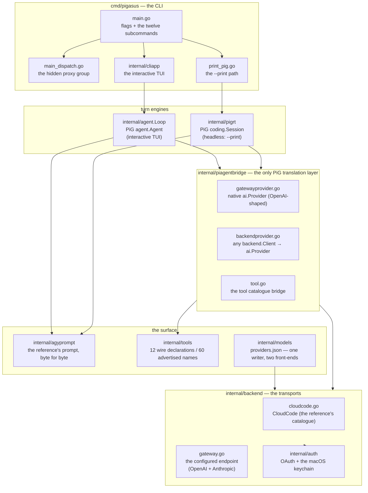

# Architecture

> How the clone is wired: the packages, the two turn engines, the two
> transports. The detail per subsystem is in the sibling files of this guide.

## The map

## The packages that matter

| Package | What it owns |
|---|---|
| `cmd/pigasus` | the CLI: flags, the twelve visible subcommands, the hidden `proxy` group, and the early `agy` dispatch (before the parser exists) |
| `internal/agent` | the TUI's turn engine — `Loop.Send` delegates to PiG's `agent.Agent`; `pig.go` is the translation layer |
| `internal/pigrt` | the headless turn engine — a wrapper around PiG's `coding.Session`, plus the `mcp.json` bridge, the skill roots and the out-of-band error slot |
| `internal/piagentbridge` | the only place that speaks PiG: `backend.Client` → `ai.Provider`, the tool catalogue bridge, the stall watcher, the native gateway provider |
| `internal/backend` | the two transports: `cloudcode.go` (the reference's wire) and `gateway.go` (the configured endpoint, OpenAI + Anthropic) |
| `internal/auth` | OAuth, the token store, the quota and plan-tier queries |
| `internal/models` | `providers.json`: the registry, its single writer (`Editor`) and the ordered-JSON editor |
| `internal/cli` | the reference's *visible* CLI surface, plus the hidden `provider` / `model` registry commands |
| `internal/tools` | the tool catalogue: 60 advertised names, 12 wire declarations, the executors and the result texts |
| `internal/agyprompt` | the reference's system prompt, rebuilt byte for byte, and the skill/rule discovery |
| `internal/agenttools` | the seven declarations a custom `--agent` gets |
| `internal/tuilib`, `internal/cliapp` | the TUI widgets and the panels |
| `internal/agyproxy`, `internal/agybin` | the CloudCode proxy and the vendor-binary resolver |
| `internal/convstore` | the read-only SQLite reader for the conversation store |
| `internal/referencedrift` | the gate that notices when the reference binary moves |

## The two turn engines

| Engine | Owns | Where |
|---|---|---|
| `internal/pigrt` (PiG `coding.Session`) | **`--print`** — the whole headless surface | `internal/printmode/print_pig.go` |
| `internal/agent.Loop` (PiG `agent.Agent`) | the **interactive TUI** only | `internal/cliapp` |

They share one bridge (`internal/piagentbridge`) and one transport
(`internal/backend`), which is why the native provider and the gateway client
have to stay behaviourally identical: the TUI and the headless path must
produce the same bytes on the wire.

## The two transports

| The model is… | Transport | Endpoint |
|---|---|---|
| in the reference's catalogue (Gemini / Claude / GPT-OSS) | `backend.CloudCodeClient` | `https://daily-cloudcode-pa.googleapis.com/v1internal:streamGenerateContent?alt=sse` |
| configured by the user | `backend.GatewayClient` | `<base>/chat/completions` (OpenAI) or `<base>/v1/messages` (Anthropic) |

The split happens at start-up (`pickBackendWithLog`) and again on every
`/model` change in the TUI. See [`models.md`](models.md).

## The recovered surface

The reference binary's own tool and gRPC catalogues were recovered in the early
cycles and are described in the cycle reports (`docs/cycles/cycle-25*`,
`cycle-29*`). They are **not** the clone's current surface: the clone
advertises the reference's twelve wire declarations and sixty tool names, and
the recovered `--tool` / `--services` flags were removed to keep the flag
surface byte-identical to the reference's.
