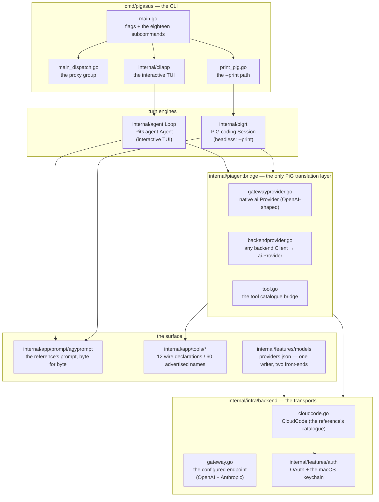

# Architecture

> How the clone is wired: the packages, the two turn engines, the two
> transports. The detail per subsystem is in the sibling files of this guide.
>
> This file is the **wiring**. The **directory layout** — the five tiers under
> `internal/` and the facades that still sit at the old paths — is
> [`architecture-tiers.md`](architecture-tiers.md).

## The map

## The packages that matter

| Package | What it owns |
|---|---|
| `cmd/pigasus` | the CLI: flags, the eighteen visible subcommands (the reference's twelve plus the clone's six), and the early `agy` dispatch (before the parser exists) |
| `internal/agent` | the TUI's turn engine — `Loop.Send` delegates to PiG's `agent.Agent`; `pig.go` is the translation layer |
| `internal/pigrt` | the headless turn engine — a wrapper around PiG's `coding.Session`, plus the `mcp.json` bridge, the skill roots and the out-of-band error slot |
| `internal/piagentbridge` | the only place that speaks PiG: `backend.Client` → `ai.Provider`, the tool catalogue bridge, the stall watcher, the native gateway provider |
| `internal/infra/backend` | the two transports: `cloudcode.go` (the reference's wire) and `gateway.go` (the configured endpoint, OpenAI + Anthropic) |
| `internal/features/auth` | OAuth, the token store, the quota and plan-tier queries |
| `internal/features/models` | `providers.json`: the registry, its single writer (`Editor`) and the ordered-JSON editor |
| `internal/cli` | the CLI surface: the reference's twelve visible subcommands plus the clone's `provider` / `model` / `accounts` / `proxy` / `web` / `halloween` |
| `internal/app/tools` | the tool **contract**: `Tool`, `Registry`, `ArgsOf`, the result stamp, the failure text, the reference fixtures |
| `internal/app/tools/{shell,filesystem,browser,web,tasks}` | the tool **capabilities**: the six executors, each in its own package |
| `internal/app/tools/surface` | the tool **catalogue**: 60 advertised names, 12 wire declarations, the harness declarations |
| `internal/app/prompt/agyprompt` | the reference's system prompt, rebuilt byte for byte, and the skill/rule discovery |
| `internal/app/prompt/agytemplates` | the reference's seventeen recovered `.tmpl` files, embedded once, with their digests |
| `internal/app/prompt/step` | the reference's step strings (rendered from `step_strings/*.tmpl`) and the reader for both command-result shapes |
| `internal/app/agenttools` | the seven declarations a custom `--agent` gets |
| `internal/ui/tuilib`, `internal/ui/views/*` | the TUI widgets and the panels |
| `internal/cliapp` | the interactive TUI's **host**: the turn loop, the transcript, the streaming, the composer and the slash dispatch |
| `internal/infra/agyproxy`, `internal/infra/proxy/bin` | the CloudCode proxy and the vendor-binary resolver |
| `internal/app/session/convstore` | the read-only SQLite reader for the conversation store |
| `internal/infra/referencedrift` | the gate that notices when the reference binary moves |

## The two turn engines

| Engine | Owns | Where |
|---|---|---|
| `internal/pigrt` (PiG `coding.Session`) | **`--print`** — the whole headless surface | `internal/printmode/print_pig.go` |
| `internal/agent.Loop` (PiG `agent.Agent`) | the **interactive TUI** only | `internal/cliapp` |

They share one bridge (`internal/piagentbridge`) and one transport
(`internal/infra/backend`), which is why the native provider and the gateway client
have to stay behaviourally identical: the TUI and the headless path must
produce the same bytes on the wire.

## The two transports

| The model is… | Transport | Endpoint |
|---|---|---|
| in the reference's catalogue (Gemini / Claude / GPT-OSS) | `backend.CloudCodeClient` | `https://daily-cloudcode-pa.googleapis.com/v1internal:streamGenerateContent?alt=sse` |
| configured by the user | `backend.GatewayClient` | `<base>/chat/completions` (OpenAI) or `<base>/v1/messages` (Anthropic) |

The split happens at start-up (`internal/infra/backend/select`'s `Pick`
and `PickWithLog`) and again on every `/model` change in the TUI. See
[`models.md`](models.md).

## The recovered surface

The reference binary's own tool and gRPC catalogues were recovered in the early
cycles and are described in the cycle reports (`docs/cycles/cycle-25*`,
`cycle-29*`). They are **not** the clone's current surface: the clone
advertises the reference's twelve wire declarations and sixty tool names, and
the recovered `--tool` / `--services` flags were removed to keep the flag
surface byte-identical to the reference's.
