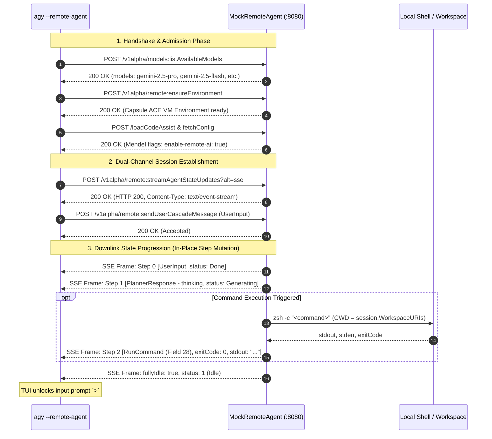

# Remote Agent Protocol & Local Mock Server SOP

> **Architecture & Operational Guide.** Clean-room reverse engineering, local mock server operations, wire protocol specification, and binary asset extraction for `agy --remote-agent`.

---

## 1. Overview & Problem Statement

In the official Antigravity (`jetski/cortex`) architecture, running `agy --remote-agent` enables remote cloud-hosted agent orchestration:
- Turns run inside isolated Google Cloud VM containers (Capsule / ACE VM).
- State and tool steps synchronize over Google Cloud Code (`aicode.googleapis.com`) using a proprietary dual-channel cascade session protocol.

### The Problem
Official cloud access requires Google Cloud internal/enterprise account whitelisting. Unprivileged accounts encounter Mendel licensing rejections (`PermissionDenied`, `enable-remote-ai: false`, or HTTP 403/404) at runtime.

### The Solution: 100% Local Mock Server
OpenAGY provides a clean-room reference server ([`internal/infra/mockremoteagent`](../../internal/infra/mockremoteagent)) and standalone CLI daemon ([`cmd/mock-remote-agent`](../../cmd/mock-remote-agent)). By redirecting the official client to the local server via `AICODE_ENDPOINT_URL`, users can run `agy --remote-agent` with full interactive TUI widgets, real workspace execution, and **zero dependency on Google Cloud whitelisting**.

---

## 2. SOP 1: Quickstart & Local Integration (联调操作 SOP)

### 2.1 Start the Mock Server

Run the server via `go run` or compile it into your path:

```bash
# Option A: Run directly from repo root
go run ./cmd/mock-remote-agent --addr 127.0.0.1:8080

# Option B: Build binary
go build -o /tmp/mock-remote-agent ./cmd/mock-remote-agent
/tmp/mock-remote-agent --addr 127.0.0.1:8080 --model gemini-3.8-flash-high

# Option C: the same server as a pigasus subcommand
pigasus agent-server --addr 127.0.0.1:8080 --model gemini-3.8-flash-high
```

`pigasus agent-server` and `mock-remote-agent` are the same implementation
(`internal/rchost/agentserver`); the standalone binary is kept for scripts.

`--model` is the **Pigasus-side** setting: it selects the reference model
(id or label) or a configured `providers.json` model that actually serves the
turn. `OPENAGY_MODEL` is the fallback when the flag is omitted. The remote
client's model picker only changes its own TUI; it does not override this
choice. `--real-agent=false` keeps the deterministic protocol stub (useful for
wire tests), and `--cloudcode-endpoint` defaults to
`https://daily-cloudcode-pa.googleapis.com`.

Console output indicates readiness:
```
Mock Remote Agent Server running at http://127.0.0.1:8080
Execution Engine: Real Pigasus Agent (rchost/actor/tools) (model: gemini-3.8-flash-high)
Ready to accept agy --remote-agent client requests on:
  http://127.0.0.1:8080/google.gca.aicode.v1main.JetskiRemoteAgentProxyService/
Press Ctrl+C to stop.
```

### 2.2 Launch the Official `agy` Client

In a separate terminal, point both the remote-agent and CloudCode/Mendel
endpoints at the mock server on the command line. `env` scopes the variables
to that one process, so they do not leak into the rest of the shell:

```bash
# Launch the official agy binary (e.g. installed at ~/.local/bin/agy)
env AICODE_ENDPOINT_URL=http://127.0.0.1:8080 CLOUD_CODE_URL=http://127.0.0.1:8080 agy --remote-agent
```

> **Both variables are required for `agy`.** With only `AICODE_ENDPOINT_URL`,
> `agy` still resolves the cloud project against
> `https://daily-cloudcode-pa.googleapis.com` and fails with
> `reading cloud project <id>: listing cloud projects: failed_precondition:
> cloud conversations are not enabled for this user` (also visible as
> `Failed to resolve cloud project` in `--log-file`). The mock already serves
> every cached project id, so the failure is the missing `CLOUD_CODE_URL`,
> not a missing project.

### 2.3 `pigasus --remote-agent`

`pigasus` is itself a remote-agent client. It speaks the same REST/SSE
dialect as `agy` and needs only `AICODE_ENDPOINT_URL` (no `CLOUD_CODE_URL`,
because it never resolves projects through the CloudCode endpoint):

```bash
AICODE_ENDPOINT_URL=http://127.0.0.1:8080 pigasus --remote-agent
# optional: --project "<project id or title>" or --project <id>
```

The session is a thin client in the same sense as `agy`:

- the first turn calls `startCascade`; later turns call
  `sendUserCascadeMessage` on the same cascade;
- `streamAgentStateUpdates` drives the transcript: planner text/thinking,
  `run_command` tool rows, and generic tool rows (`view_file`, `write_file`,
  `search_web`, ...) keep their real names and results;
- `--project` resolves an id or a title through `listProjects`;
- the proxy's `listSlashCommands` entries join the local `/` menu;
- `/clear` starts a new remote cascade instead of continuing the discarded
  one;
- the model is sent as the catalogue id (`gemini-3.8-flash-high`), even when
  `/model` displayed the human label.

`Esc` cancels the in-flight turn and calls `cancelCascade`. An unreachable
proxy surfaces the HTTP error in the transcript and leaves the prompt usable.

### 2.4 Verify Interactive Execution

Once inside the `agy` TUI prompt (`>`):
1. **Chat / Planning**:
   Type any general query (e.g. `hello` or `what can you do`).
   - The TUI renders the thinking block via native `PlannerResponse`.
2. **Execute Real Workspace Commands**:
   Type `run <command>`, for example:
   ```
   > run date
   ```
   or
   ```
   > run ls -la
   ```
   - The TUI renders the native folding widget `● Bash(date)` or `● Bash(ls -la)`.
   - The command executes inside your current workspace directory via your local shell (`zsh` on macOS, `sh` on Linux).
   - Once execution finishes, the output is captured into `stdout` / `combinedOutput`, and the prompt unlocks immediately.

---

## 3. SOP 2: Protocol Specification & Wire Architecture

### 3.1 Architecture & Flow



### 3.2 Endpoint Interception Seams

Official binary decompilation confirms that `agy` reads two environment variables to route remote calls:
1. **`AICODE_ENDPOINT_URL`**:
   - Default if unset: `https://aicode.googleapis.com`.
   - Overrides all base URLs for `remote_agent_proxy` RPCs (`JetskiRemoteAgentProxyService`, `fetchConfig`, etc.).
2. **`CLOUD_CODE_URL`**:
   - Default if unset: `https://daily-cloudcode-pa.googleapis.com`.
   - Overrides CloudCode services (`loadCodeAssist`, `listExperiments`, `fetchAvailableModels`, `onboardUser`).
   - **Crucial for non-whitelisted consumer accounts**: If `CLOUD_CODE_URL` is omitted, the official client periodically refreshes experiment flags against Google's live CloudCode endpoint. Because consumer accounts lack Google's server-side remote agent whitelist, Google's live server returns flags without `enable-remote-ai`, which clobbers the local Mendel cache and triggers `failed_precondition: cloud conversations are not enabled for this user`. Pointing both variables to the mock server guarantees complete local isolation and uninterrupted access:
     ```bash
     AICODE_ENDPOINT_URL=http://127.0.0.1:8080 CLOUD_CODE_URL=http://127.0.0.1:8080 agy --remote-agent
     ```

### 3.3 Downlink SSE Stream Requirements

- **Route**: `POST /v1alpha/remote:streamAgentStateUpdates?alt=sse`
- **Important Wire Quirk**: The official client **does not send** an `Accept: text/event-stream` header. The server **must** inspect the query parameter `?alt=sse` to activate the SSE streaming loop.
- **Frame Wire Format**:
  ```http
  HTTP/1.1 200 OK
  Content-Type: text/event-stream
  Cache-Control: no-cache
  Connection: keep-alive

  data: {"update":{"conversationId":"cascade-1","executableStatus":2,"executorLoopStatus":2,"fullyIdle":false,"mainTrajectoryUpdate":{"lastStepType":14,"status":2,"stepsUpdate":{"indices":[0],"pageBounds":{"startIndex":0,"endIndexExclusive":1},"steps":[{"metadata":{"source":4},"status":3,"type":14,"userInput":{"items":[{"text":"run date"}],"query":"run date"}}],"totalLength":1},"trajectoryId":"traj-1"},"status":2,"trajectoryId":"traj-1"},"resumeToken":"tok-1"}

  ```
- **Monotonic Sequence**: Every frame advances `resumeToken` (`tok-1`, `tok-2`, ...). The client sends `resumeToken` upon reconnection.

### 3.4 Step Types & Status Codes (Proto3-JSON)

| Code | Name | Proto Field | Wire Meaning |
|---|---|---|---|
| **14** | `CORTEX_STEP_TYPE_USER_INPUT` | `userInput` | Step created from user prompt |
| **15** | `CORTEX_STEP_TYPE_PLANNER_RESPONSE` | `plannerResponse` | Assistant thoughts (`thinking`) |
| **21** | `CORTEX_STEP_TYPE_RUN_COMMAND` | `runCommand` (Field 28) | Shell command with stdout, stderr, exitCode |
| **5** | `CORTEX_STEP_TYPE_CODE_ACTION` | `codeAction` | File creation/edit diff representation |
| **132**| `CORTEX_STEP_TYPE_GENERIC` | `generic` | Fallback notification or status step |

#### Execution Status Values:
- **`step.status`**: `2` = Running / In-Progress, `3` = Done / Completed, `8` = Generating.
- **`trajectory.status`** & **`executableStatus`**: `1` = Idle, `2` = Running.
- **`fullyIdle` Flag**: When a turn completes, the server must emit `fullyIdle: true` and `status: 1`. Missing this flag causes the client TUI to hang indefinitely awaiting further tool calls.

### 3.5 RPC Method Mapping

The service supports both REST paths (`/v1alpha/remote:...`) and gRPC-web/HTTP path styles (`/google.gca.aicode.v1main.JetskiRemoteAgentProxyService/...`):

| Method / Subsystem | Path | Description |
|---|---|---|
| **Environment** | `/v1alpha/remote:ensureEnvironment` | Prepares Capsule VM container environment |
| **Model Catalog** | `/v1alpha/models:listAvailableModels` | Returns supported model IDs and display names |
| **Stream Updates** | `/v1alpha/remote:streamAgentStateUpdates` | SSE state machine downlink stream |
| **Send Message** | `/v1alpha/remote:sendUserCascadeMessage` | User prompt uplink endpoint |
| **Cancel Turn** | `/v1alpha/remote:cancelTurn` | Cancels the active generating turn |
| **Title Generator**| `/v1alpha/remote:generateConversationTitle` | Generates conversation title |
| **Diffs** | `/v1alpha/remote:getTurnDiff`, `getCodeActionDiff` | Retrieves unified diffs for turn or code changes |
| **Terminals** | `/v1alpha/remote:createTerminal`, `listTerminals`, `streamTerminalOutput`, `closeTerminal` | Terminal multiplexer emulation |
| **Projects** | `/v1alpha/remote:uploadProjectFile`, `updateProject`, `deleteProject` | Workspace project management |
| **Triggers** | `/v1alpha/remote:listTriggers`, `createTrigger`, `updateTrigger`, `deleteTrigger` | Automation triggers |
| **Permissions** | `/v1alpha/remote:addPermissionGrants`, `removePermissionGrants` | Dynamic permission grants |

### 3.6 `pigasus --remote-agent` client coverage

`pigasus` is a client, so it implements the RPCs a client session uses — not
the server's administrative surface. The current split:

| RPC | Client | Used by `pigasus --remote-agent` |
|---|---|---|
| `ensureEnvironment` | ✅ | once, before the first `startCascade` |
| `listProjects` / `readProject` | ✅ | `--project` resolution |
| `startCascade` | ✅ | first turn |
| `sendUserCascadeMessage` | ✅ | later turns |
| `streamAgentStateUpdates` | ✅ | every turn |
| `cancelCascade` | ✅ | Esc / turn cancellation |
| `listSlashCommands` | ✅ | the `/` menu |
| `readDir` / `readFile` | ✅ | `@` file completion |
| `getPermissionSettings` / `setPermissionPreset` | ✅ | `/permissions` reads and writes the remote preset |
| `getConversation` | ✅ | `/continue` and `--continue` attach to the stored cascade |
| `generateConversationTitle` | ✅ | exposed; the host keeps its local title |
| `handleCascadeUserInteraction` | ✅ | permission modal + subagent-question picker answer `WAITING` steps |
| `getTurnDiff` | ✅ | `/diff` in a remote session: the All Changes tab + inline body |
| `getCodeActionDiff` | ✅ | the inline view of a file whose code-action/file-change step is known |
| `createTerminal` / `listTerminals` / `sendTerminalInput` / `streamTerminalOutput` / `closeTerminal` | ✅ | `/terminal` (host-only) drives a real server PTY |
| `listCustomizations` | ✅ | `/skills` and the `/` menu (WorkflowSpec skills) |
| `listPlugins` / `listPluginInstallations` | ✅ | `/plugin list` in a remote session |
| `installPlugin` / `uninstallPlugin` | ✅ | `/plugin install|uninstall` (target REMOTE) |
| `uploadProjectFile` | ✅ | `/upload <path>` (host-only) creates a project resource |
| `listTriggers` / `listTriggerOptions` / `createTrigger` / `updateTrigger` / `deleteTrigger` | ✅ | `/triggers` (host-only) |
| `updateProject` / `deleteProject` | n/a (out of scope) | destructive project administration, not used by a single session |
| CloudCode auth/model RPCs (`loadCodeAssist`, `fetchAvailableModels`, …) | n/a | pigasus's own auth/model stack owns these; they are not remote-agent RPCs |

In a remote session `/plugin list` reads the proxy's plugin catalogue and
installations, and `/plugin install|uninstall <id>` writes them remotely.

`/skills` reads the proxy's `listCustomizations` response: each
`exa.cortex_pb.WorkflowSpec` becomes a skill row (`displayName`/`name`,
`description`, `path`, `pluginName`, `icon`, `isBuiltin`), and
`disableSlashCommand` entries are hidden. The engine caches the list so the
`/` menu does not block; `/skills reload` clears the cache and refetches.

In a remote session `/permissions` shows the server's preset
(`Remote permission preset: …`) and `/permissions <preset>` writes it; the
local rule list is not shown because the remote agent does not read it.

In a remote session `/diff` calls `getTurnDiff`: the All Changes tab lists
the proxy's files with their line counts, and the inline view is the
unified diff of the two versions `FileDiffData` carries. When the turn
streamed a `CODE_ACTION` (5) or `FILE_CHANGE` (86) step for a file, the
inline view uses that step's `getCodeActionDiff` block instead — the same
block the reference renders. `pigasus agent-server` emits that step for
the file-mutating tools (create/write/edit/sed) with the DiffBlock already
attached. `DiffBlock`'s unified-diff line types are
recovered from the reference descriptor: `UNIFIED_DIFF_LINE_TYPE_INSERT`
(1), `DELETE` (2), `UNCHANGED` (3), `UNSPECIFIED` (0). The header names
the source `remote`, and the panel never reads the client's own git tree.

There is no turn id in this protocol. `GetTurnDiffRequest` carries
`conversation_id` + `step_index`; the response returns the turn as
`turn_start_index` .. `turn_end_index_exclusive`. A turn is therefore a step
range, not an addressable object — the actor's `TurnHandle` is a local
identity and must not be mapped onto it.

`/triggers` lists, creates, pauses/resumes and deletes remote triggers
(`triggerId`, `state`, `displayName`, `prompt`, `optionId`, `fields`).
Like `/terminal` and `/upload`, it is a host-only command: the reference
exposes triggers to its IDE/web automation UI, not to the CLI.

`/upload <path>` reads a local file and uploads it with
`uploadProjectFile`, then reports the created resource id and size. Like
`/terminal`, it is a host-only extension: the reference exposes the RPC to
its IDE/web client, not as a CLI slash command.

Remote terminals use the same conversation workspace: `/terminal` lists or
creates one, `/terminal run <command>` runs a command and streams its output
into the transcript, and `/terminal close [id]` ends it. This is a
host-only extension — the reference exposes terminals to its IDE/web client,
not to the CLI — so the command is registered by the host and deliberately
absent from the `/` catalogue. The proxy spawns a login shell on a real PTY
(`creack/pty`) and keeps the scrollback so `streamTerminalOutput` can resume
from an offset.

Path matching caveat: the step's `absolutePathUri` is joined to the
client's workspace. On a same-machine proxy that is exact; a genuinely
remote workspace with a different absolute root falls back to the
`getTurnDiff` contents (which are server-relative and need no joining).

Remote turns park on a `WAITING` step (status 9) in two shapes: an
`ask_question` (type 138) or a permission request on a generic step. The
TUI raises the permission modal (y/a/n/d) or the subagent-question picker,
then posts `handleCascadeUserInteraction` with the proxy's payload —
`conversationId` plus `interaction.{trajectoryId, stepIndex, permission|askQuestion}`.
`pigasus agent-server` implements the other half: its interaction host
publishes the waiting step and resolves it from that RPC.

### 3.7 Scope and remaining work

> The openagy-only surfaces built on these RPCs (`/terminal`, `/upload`,
> `/triggers`, and the hidden-command rules) are **indexed** in
> [`pigasus-extensions.md`](pigasus-extensions.md); their descriptions stay
> here and in [`hidden-commands-and-flags.md`](hidden-commands-and-flags.md).

Done and verified: remote `@` files (`readDir`), `WAITING` question /
permission steps, remote `/continue`, remote `/permissions`, remote
`/plugin list|install|uninstall`, remote `/diff` (`getTurnDiff`,
`getCodeActionDiff`), the terminal RPCs and their `/terminal` output path,
remote `/skills` (`listCustomizations`), `/upload`
(`uploadProjectFile`), and trigger management
(`listTriggers`/`createTrigger`/`updateTrigger`/`deleteTrigger`).

**No open items remain for a single `pigasus --remote-agent` session.**

Explicitly out of scope (they are server administration, not session
features):

- **`updateProject` / `deleteProject`** — mutating or destroying a cloud
  project. A session resolves and reads its project; it never rewrites the
  project list. Exposing these would be a separate, destructive admin
  surface with its own confirmation rules.
- **Project-resource CRUD beyond upload** — `readProjectResource` /
  `updateProjectResources` manage the project's resource catalogue; a
  session only attaches files (`uploadProjectFile`).

Not applicable:

- **`/config` "Remote" page** — no such reference surface was recovered.
  The remote permission preset lives in `/permissions` instead.

---

## 4. SOP 3: Binary Asset & Protobuf Descriptor Extraction

When upgrading to newer reference versions (e.g. `1.5.x`), follow this SOP to extract embedded assets and check for protocol changes.

### 4.1 Extract Embedded Go Resources & Web Assets

Use the optimized extractor in [`devutils/embedextract`](../../devutils/embedextract):

```bash
# Extract from target binary into destination directory
go run ./devutils/embedextract /path/to/agy /path/to/output_dir
```

For `agy 1.5.3`:
```bash
go run ./devutils/embedextract ~/.local/bin/agy out/extracted-1.5.3
```

**Output Layout**:
- `embed/`: 499 embedded files:
  - Built-in syntax highlighting lexers (`*.xml`) and color themes.
  - Native Swarm plugin with the `swarm_board` Sidecar UI (`index.html`, `hive.js`, etc.).
  - Built-in skills (`native_swarm`, `generative_ui`, `antigravity_guide`, etc.).
- `web-assets/`: 548 uncompressed web frontend assets (from embedded ZIP archive 1, ~20 MB):
  - Frontend SPA: `main.js` (11.8 MB), `index.html`, `jetbox.css`, `compiled_tailwind.css`.
  - Voices: Audio models in `voices/` (`arlo`, `cleo`, `finn`, `fola`, `gero`, `lora`, etc.).
  - Workers: `pdf.worker.mjs`, `shiki_worker.js`, `diff_worker.js`.

### 4.2 Extract Protobuf Descriptors Directly from Binary

Protobuf runtime files in Go binaries retain serialized `FileDescriptorProto` structures. Use [`out/local-macos/extract_descriptors.py`](../../out/local-macos/extract_descriptors.py):

```bash
# Usage: python3 out/local-macos/extract_descriptors.py <binary> <proto-path> > <outfile.txt>

# 1. Remote Agent Proxy Service
python3 out/local-macos/extract_descriptors.py ~/.local/bin/agy \
  google/gca/aicode/v1main/remote_agent_proxy.proto \
  > out/extracted-1.5.3/protos/remote_agent_proxy_1.5.3.txt

# 2. Jetski Remote Agent PB
python3 out/local-macos/extract_descriptors.py ~/.local/bin/agy \
  third_party/jetski/remote_agent_proxy_pb/remote_agent_proxy.proto \
  > out/extracted-1.5.3/protos/remote_agent_proxy_pb_1.5.3.txt

# 3. Cortex PB
python3 out/local-macos/extract_descriptors.py ~/.local/bin/agy \
  third_party/jetski/cortex_pb/cortex.proto \
  > out/extracted-1.5.3/protos/cortex_1.5.3.txt

# 4. Trajectory & Trajectory Steps
python3 out/local-macos/extract_descriptors.py ~/.local/bin/agy \
  third_party/gemini_coder/proto/trajectory.proto \
  > out/extracted-1.5.3/protos/trajectory_1.5.3.txt

python3 out/local-macos/extract_descriptors.py ~/.local/bin/agy \
  third_party/gemini_coder/cider/proto/trajectory_steps.proto \
  > out/extracted-1.5.3/protos/trajectory_steps_1.5.3.txt
```

### 4.3 Version Diffing Methodology (e.g. 1.4.8 vs 1.5.3)

Run a fast diff comparison script against extracted descriptors:

```python
import re

m148 = set(re.findall(r'message_type\s*\{\s*name:\s*\"([^\"]+)\"', open('out/local-macos/protos/remote_agent_proxy_1.4.8.txt').read()))
m153 = set(re.findall(r'^message\s+([A-Za-z0-9_]+)\s*\{', open('out/extracted-1.5.3/protos/remote_agent_proxy_1.5.3.txt').read(), re.M))

print("New Messages in 1.5.3:", sorted(list(m153 - m148)))
print("Removed Messages in 1.5.3:", sorted(list(m148 - m153)))
```

#### Key Findings from the 1.4.8 $\to$ 1.5.3 Drift:
1. **Message Volume**: Expanded from 174 messages to 200 messages (+27 new, -1 deprecated).
2. **Voice Trajectory RPCs**: Introduction of voice interactions (`StreamVoice`, `ListVoiceTrajectories`, `GetVoiceTrajectoryDebug`, `DeleteVoiceTrajectories`).
3. **Sidecar Lifecycle**: New sidecar discovery and reporting messages (`ListEnvironmentSidecars`, `ReportEnvironmentSidecars`).
4. **Customizations API**: First-class remote query endpoints for user configurations (`ListCustomizations`).
5. **Path Relocation**: `trajectory_steps.proto` moved to `third_party/gemini_coder/cider/proto/trajectory_steps.proto`.

---

## 5. Testing & Verification

Run the test suite to verify the mock server implementation:

```bash
# Run mock remote agent tests (all 7 tests)
go test -v ./internal/infra/mockremoteagent/...

# Run architecture guard
make arch

# Full quick check
make quick
```
